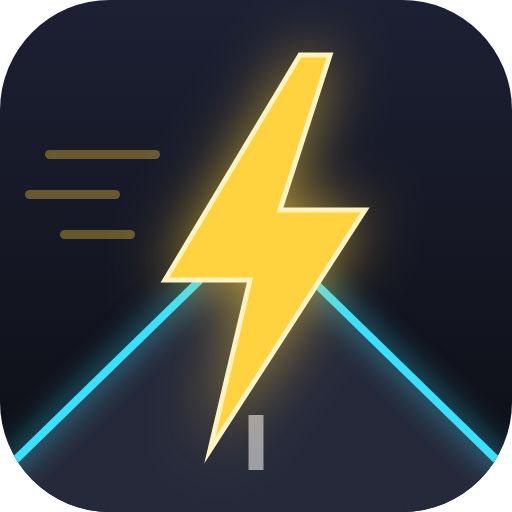

<h1 align="center">🏁 Boltrush</h1>

An arcade racer by <b>Ninebolt Studios</b>. Free in your browser on iPhone, iPad, Android and PC.

<b><a href="https://ninebolt-studios.github.io/Boltrush/">▶ PLAY NOW</a></b>

- ▶ **Play:** https://ninebolt-studios.github.io/Boltrush/
- 📲 **App (iPhone/iPad):** https://ninebolt-studios.github.io/Boltrush/Boltrush.mobileconfig
- 🌐 **Ninebolt Studios:** https://ninebolt-studios.github.io/Ninebolt-Studios-Website/

## Features
- 🏁 Race 7 adaptive rivals (they push harder when you lead, ease off when you're behind) on 3 tracks (Neon Harbor, Dust Canyon, Frost Pass), or do time trials
- 💨 Drift combos (×2…×5) that fill nitro and pay bonus coins, plus slipstream
- ⚡ Item boxes: 🚀 turbo, ⚡ shock, 🛡️ shield
- 🚀 Ramps for big air, cones and barrels that go flying, real car-to-car collisions
- ✨ Glow (bloom) graphics, skid marks, tyre smoke and sparks, with an automatic Fast mode for slower devices
- 🎓 2-minute tutorial (◎ 250 the first time)
- ☁️ Accounts: same login as Ashfall, so your coins, cars and best times are never lost
- 🎮 Keyboard, touch and controller support
- 👻 Ghost racer in Time Trial
- 🎁 Daily rewards + 🏆 11 achievements
- ⚙️ Settings: sound, camera, steering feel, km/h or mph, touch button size, minimap, graphics
- 🎁 Gift codes (Settings → Codes)

## 🗂️ How the code is organised
- `index.html`: just the page layout (menus, HUD, buttons). It loads everything else
- `js/game.js`: the whole game in JavaScript (three.js 3D engine)
- `css/style.css`: all the styling
- `sw.js`: offline support so the game works without internet
- `tools/release.py`: Python release helper. It checks the scripts and bumps the version stamps, which also triggers the in-game auto-updater for everyone (`python3 tools/release.py`)

## Updates
| Version | What's new |
|---|---|
| **v5** | **👻 Ghost racer:** in Time Trial your best lap replays as a see-through car to race against (beat it and it becomes your new ghost). **🎁 Daily rewards:** claim coins every day, 7-day streak up to ◎ 400. **🏆 11 achievements** with coin rewards (Big Air, Sideways 2,000-point drift, Shocker, World Tour, Full Garage and more) and a trophy list with progress bars |
| **v4.4** | **Runs smoother:** everything that never moves (buildings, trees, lamps, the car bodies) is now merged into a few big pieces, so each frame draws 36–59% less (Frost Peak went from 670 draw calls to 274). **Fast graphics** now really lightens the load (lower resolution and no shadows, not just no glow), and the game switches to it by itself if your device struggles mid-race |
| **v4.3** | **Auto-updater** (like Ashfall): when a new version comes out, the game updates itself the next time you're in the menu (never in the middle of a race) and says "✨ Updated to the newest version!" |
| **v4.2** | **Real JavaScript project:** the game code now lives in `js/game.js` and the styling in `css/style.css` instead of being packed into one HTML page, plus a Python release tool (`tools/release.py`). Same game, it just loads from proper files |
| **v4.1** | Phone polish: results and pause screens always fit (no more cut-off Race Again button on a sideways phone), touch buttons keep their spacing when they shrink (Brake no longer covers ▶ on small phones), compact HUD on short screens, menu logo fits on phones |
| **v4** | **⚙️ Settings** (sound, camera distance, steering feel, km/h or mph, touch button size, minimap, graphics), **🎁 codes** (gift codes for coins or cars), the **Ninebolt Studios intro**, and **iPad fix**: the touch buttons always stay on screen (they size themselves to your screen and the page can't zoom or scroll anymore) |
| **v3** | **Adaptive rivals** (if you're winning they push harder to catch you, if you're behind they ease off so you can get back in it), **accounts** (same login as Ashfall; progress from every device is merged, nothing is ever lost), **glow graphics** (bloom + colour grade, auto-lowers if your device struggles, toggle with ✨ Graphics), street lamps, billboards, a grandstand with a crowd, better cars (rims, skirts, brake lights that light up, headlight beams at night), fixed rocks and buildings that stuck into the road |
| **v2** | Collisions with sparks and spin-outs, ⚡ item boxes, ramps, flying cones and barrels, drift combos, slipstream, skid marks and smoke, tutorial, app icon + install |
| **v1** | First release: 3 tracks, 4 cars, 8 paints, races and time trials |
